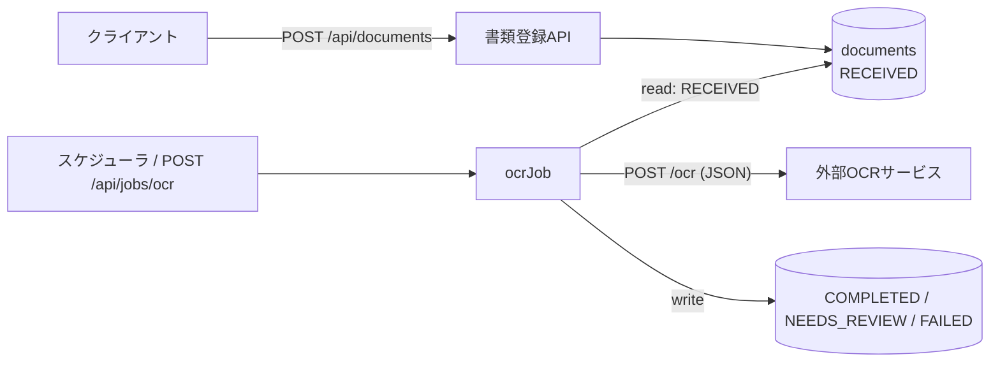

# document-ocr-batch


書類を受け付ける **REST API** と、受け付けた書類を **外部OCRサービスと REST/JSON で連携して処理するバッチ** のサンプルです。
業務で担当してきた「外部システム連携バッチ（Spring Boot / REST API / JSON）」の構成を、小さく再現しています。

## 技術スタック

- Java 21 / Spring Boot 3.5
- Spring Web（REST API、`RestClient` による外部API呼び出し）
- Spring Batch（チャンク処理、リトライ、スキップ）
- Spring Data JPA / H2
- JUnit 5 / MockMvc / MockRestServiceServer / spring-batch-test
- GitHub Actions（push ごとにビルドとテストを実行）

## 処理の流れ



| ステータス | 意味 |
|---|---|
| `RECEIVED` | 受付済み（バッチ処理待ち） |
| `COMPLETED` | OCR完了（信頼度がしきい値以上） |
| `NEEDS_REVIEW` | OCRの信頼度がしきい値未満のため、目視での確認が必要 |
| `FAILED` | 外部APIの呼び出しがリトライ後も失敗した |

## 設計で意識したこと

- **1件の失敗でジョブを止めない**：通信エラーは3回までリトライし、それでも失敗した書類はスキップして `FAILED` に記録する。残りの書類は処理を続ける
- **再実行しても安全**：処理対象は `RECEIVED` の書類だけなので、ジョブを何度実行しても処理済みの書類は二重に処理されない
- **外部APIを差し替えられる**：`OcrClient` をインターフェースにして、テストではモックに、ローカルでは疑似OCRに差し替えられるようにしている
- **エラーレスポンスの統一**：API のエラーは RFC 9457（Problem Details）形式で返す。入力チェックのエラーは項目ごとに返す
- **設定の外出し**：接続先・タイムアウト・しきい値・実行スケジュールは `application.yml` で変更できる

## 動かし方

```bash
# ローカル用プロファイル（疑似OCRが有効になり、ジョブが毎分自動で実行される）
mvn spring-boot:run -Dspring-boot.run.profiles=local
```

```bash
# 書類を登録する
curl -X POST localhost:8080/api/documents -H 'Content-Type: application/json' \
  -d '{"fileName":"invoice.pdf","content":"請求書 No.123"}'

# 信頼度の低い書類（NEEDS_REVIEW になる）
curl -X POST localhost:8080/api/documents -H 'Content-Type: application/json' \
  -d '{"fileName":"scan.png","content":"blurry scan"}'

# ジョブを手動で実行する
curl -X POST localhost:8080/api/jobs/ocr

# 結果を確認する（status で絞り込み可）
curl 'localhost:8080/api/documents?status=NEEDS_REVIEW'
```

疑似OCR（`MockOcrController`）は、本文に `blurry` を含むと低い信頼度を返し、`error` を含むと 500 エラーを返します。

## テスト

```bash
mvn test
```

| テスト | 内容 |
|---|---|
| `DocumentControllerTest` | 登録時の 201 と Location ヘッダ、入力チェックの 400、存在しないIDの 404 |
| `RestOcrClientTest` | リクエストとレスポンスの JSON、サーバーエラー時の例外変換 |
| `OcrJobTest` | 信頼度による振り分け、リトライとスキップ、再実行しても二重に処理しないこと |

## ディレクトリ構成

```
src/main/java/io/github/takicoyuki/docbatch
├── api/        REST API（Controller・リクエスト/レスポンスDTO・例外ハンドラ）
├── batch/      Spring Batch（ジョブ定義・Processor・SkipListener・スケジューラ）
├── client/     外部OCR API クライアント
├── document/   エンティティ・リポジトリ・サービス
└── mock/       ローカル用の疑似OCRサービス
```

## 開発について

このリポジトリは AI コーディングアシスタントの Claude（Anthropic）を使って作成しています。
